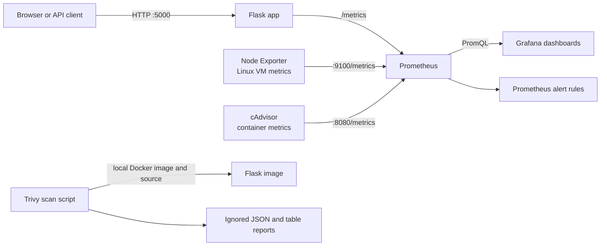

# DevOps Monitoring and Security Automation Platform

A hands-on local project for learning how to monitor a containerized service,
inspect Linux and Docker metrics, operate Prometheus alerts, and scan an image
for security findings. It runs on Windows 11 with Docker Desktop, VS Code, and
Git Bash. See [docs/architecture.md](docs/architecture.md) for the architecture
and data flow.

## What it demonstrates

- A Python Flask API with health, information, sample API, and Prometheus
  metrics endpoints.
- An IPv6-only Compose network for registry access on networks where outbound
  IPv4 is unavailable.
- Docker Compose services for Flask, Prometheus, Node Exporter, cAdvisor, and
  Grafana.
- Three provisioned Grafana dashboards for application, Linux VM, and
  container metrics.
- Prometheus rules for app availability, HTTP 5xx rate, host CPU/memory/disk,
  and container availability.
- A pinned Trivy scanner script with a HIGH/CRITICAL gate and JSON/table
  reports.
- Start, stop, status, health-check, scan, and report scripts, plus a
  production-like troubleshooting runbook.

This is a local learning environment, not a hardened production deployment.
Prometheus displays alerts locally; no Alertmanager or notification receiver
is configured. Docker Desktop's Linux metrics describe its Linux VM, not
Windows host performance. On this Docker Desktop/containerd setup, cAdvisor
does not currently expose per-container network byte counters; use
`docker stats` for local live network observations. See the specific monitoring
guides for platform details.

## Architecture



## Prerequisites

- Windows 11, Docker Desktop with its Linux engine running, Git, and Git Bash.
- VS Code recommended for editing files.
- Python 3 for the health-check script's Prometheus target parsing. Flask runs
  in its container; local Python packages are not required to launch the app.
- Registry access to download Docker images, Python packages during image
  builds, and Trivy's vulnerability database during vulnerability scans.

Check the tools from **PowerShell**:

```powershell
docker --version
docker compose version
git --version
python --version
```

Then confirm Docker Desktop's engine is available:

```powershell
docker info
```

## Configure and start

In **PowerShell** at the repository root, create a local Grafana password file
from the example, then edit `.env` in VS Code. Keep `.env` private; it is
ignored by Git.

```powershell
Copy-Item .env.example .env
code .env
```

From **Git Bash** at the repository root, build and start the stack:

```bash
bash scripts/start.sh
```

The first build downloads the pinned images and Python packages, so it needs
registry access. Open these local services:

- Flask: <http://localhost:5000>
- Prometheus: <http://localhost:9090>
- Grafana: <http://localhost:3000>
- Node Exporter: <http://localhost:9100/metrics>
- cAdvisor: <http://localhost:8080/metrics>

Use the username and password configured in `.env` to sign in to Grafana. Do
not put production credentials in this learning stack.

## Verify and operate

From **Git Bash** at the repository root:

```bash
bash scripts/status.sh
bash scripts/health-check.sh
```

The health check verifies the app and monitoring HTTP endpoints and checks
that the Flask, Node Exporter, and cAdvisor Prometheus jobs are UP. Prometheus
target health can also be viewed at <http://localhost:9090/targets>. The alert
states are at <http://localhost:9090/alerts>. Follow
[docs/alerting.md](docs/alerting.md) for controlled alert exercises.

Stop and remove the containers/network while preserving named data volumes:

```bash
bash scripts/stop.sh
```

## Trivy security scan

After the app image has been built, run from **Git Bash**:

```bash
bash scripts/security-scan.sh
```

This runs the image, dependency, and Dockerfile configuration checks. HIGH
and CRITICAL findings or an incomplete scan cause a nonzero exit. JSON and
table reports are generated in `reports/`, which is intentionally ignored by
Git. An unreachable vulnerability database means the image/dependency scans
are incomplete, not clean. Read [docs/security-scanning.md](docs/security-scanning.md)
for details.

## Repository map

```text
app/                 Flask app, dependencies, and Dockerfile
prometheus/          Scrape jobs and alert rules
grafana/             Provisioned data source and dashboards
scripts/             Local stack, health, and Trivy automation
docs/                Architecture, monitoring, alerting, security, and runbooks
reports/             Ignored local scan output; .gitkeep tracks the directory
screenshots/         Instructions for adding genuine local UI screenshots
docker-compose.yml   Local multi-container stack
```

## Pinned components

The project pins the versions used in this implementation: Python
`3.12.16-alpine3.24`, Prometheus `3.15.1`,
Node Exporter `1.12.1`, cAdvisor `0.52.1`, Grafana `13.3.0`, and Trivy `0.76.1`.
Flask and its Prometheus client are pinned in
[`app/requirements.txt`](app/requirements.txt). cAdvisor uses the official
`gcr.io/cadvisor/cadvisor` registry because the GHCR image host was unreachable
from the original workstation. The app image applies available Alpine package
upgrades during each build. Its Python dependencies and health endpoints were
verified on Alpine; review and update pins deliberately, then rerun the health
and security checks.

## Documentation

- [Architecture and data flow](docs/architecture.md)
- [Linux monitoring and PromQL](docs/linux-monitoring.md)
- [Container monitoring](docs/container-monitoring.md)
- [Grafana dashboards](docs/grafana-dashboards.md)
- [Prometheus alerting](docs/alerting.md)
- [Trivy security scanning](docs/security-scanning.md)
- [Troubleshooting scenarios](docs/troubleshooting.md)
- [Automation scripts](docs/automation.md)
- [Final verification checklist](docs/final-verification.md)
- [Interview preparation and 25 Q&A](docs/interview-prep.md)
- [Screenshot capture guide](screenshots/README.md)

## GitHub publishing (when ready)

The local project already has a Git history with separate feature/documentation
commits. When you are ready, create an **empty** GitHub repository named
`devops-monitoring-security` (do not initialize it with a README, license, or
`.gitignore`). Then run these commands in **PowerShell** from the project
folder, replacing `YOUR_GITHUB_USERNAME`:

```powershell
git remote add origin https://github.com/YOUR_GITHUB_USERNAME/devops-monitoring-security.git
git push -u origin master
```

If `origin` was already configured, inspect it with `git remote -v` and use
`git remote set-url origin https://github.com/YOUR_GITHUB_USERNAME/devops-monitoring-security.git`
instead of adding a second origin. Review `git status` and `git diff` before
publishing. Never stage `.env`, credentials, or local reports.

## Optional AWS extension

After the local stack is understood, extend it by deploying the app to ECS or
an EC2 instance and sending metrics to a secured monitoring service. Add TLS,
authentication, network controls, persistent storage, backup/retention
policies, and a tested Alertmanager receiver before treating an AWS deployment
as production-ready.
