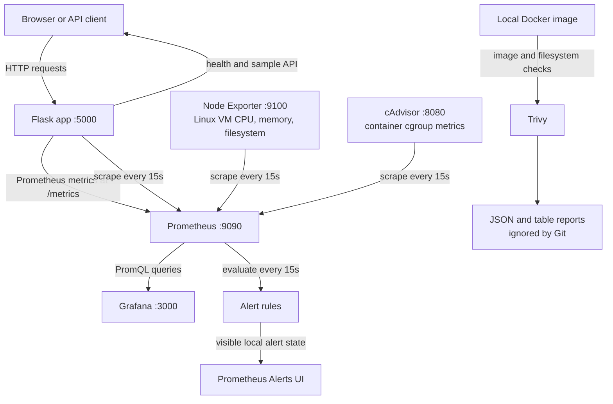

# Architecture and data flow

This Compose project runs a sample app and its monitoring tools on Docker
Desktop. Docker Desktop hosts Linux containers inside a Linux VM; the Windows
host, Linux VM, and each container are separate monitoring scopes.

## Component flow

## Metrics and alert path

Flask increments request/error counters and observes request-duration
histograms. Prometheus scrapes `/metrics`, stores time series in its named data
volume, and evaluates the rules in `prometheus/alert_rules.yml`. The rules
detect a down app, high HTTP 5xx fraction, high Linux VM CPU/memory/filesystem
use, and missing/stale cAdvisor data for the expected app image.

Node Exporter exposes operating-system counters from Docker Desktop's Linux
VM. cAdvisor reads container statistics through the containerd socket and
exposes them for Prometheus. On this configuration, some cAdvisor network
counters are absent and its container names may be generated IDs. See
[`container-monitoring.md`](container-monitoring.md).

Grafana reads Prometheus through the provisioned internal Compose URL
`http://prometheus:9090`. Provisioned dashboards show application, system,
and container metrics. Prometheus alerts are visible in its UI. No Alertmanager
or notification destination is configured, so these alert states do not send
email/chat/pager notifications.

## Security scan path

The Trivy script reads the local built app image through Docker Engine and
scans the app filesystem and Dockerfile. It gates HIGH and CRITICAL findings,
and writes JSON/table reports under `reports/`. The reports and vulnerability
database cache are local ignored files. The vulnerability database and remote
misconfiguration checks bundle need registry access; if the vulnerability
database cannot be fetched, image and dependency scans are incomplete. Trivy
can still run Dockerfile checks from embedded policies when its remote check
bundle is unavailable.

## Compose network and host ports

Containers address one another by Compose service name. For example, Grafana
uses `prometheus:9090`, and Prometheus scrapes `app:5000` and the exporter
service names. `localhost` inside a container refers to that same container.
The host port mappings make the web UIs and exporter endpoints available to
Windows at `localhost`. The Compose default network is IPv6-only because this
workstation's network has working outbound IPv6 but no outbound IPv4. The
Trivy container joins this project network so it can use the reachable route
to registries. Gunicorn binds to `[::]:5000` so the app is reachable from the
IPv6-only Compose network; the container healthcheck also uses IPv6 loopback.

## Operational boundaries

- Local development uses unauthenticated Prometheus/exporter endpoints on
  published local ports. Do not expose this configuration to a public network.
- Grafana credentials come from local `.env`, which is ignored by Git.
- Named Prometheus and Grafana volumes persist across `docker compose down`.
- This stack is a learning project; production use requires an authenticated,
  secured, durable, and monitored deployment, plus alert delivery and tested
  recovery procedures.
